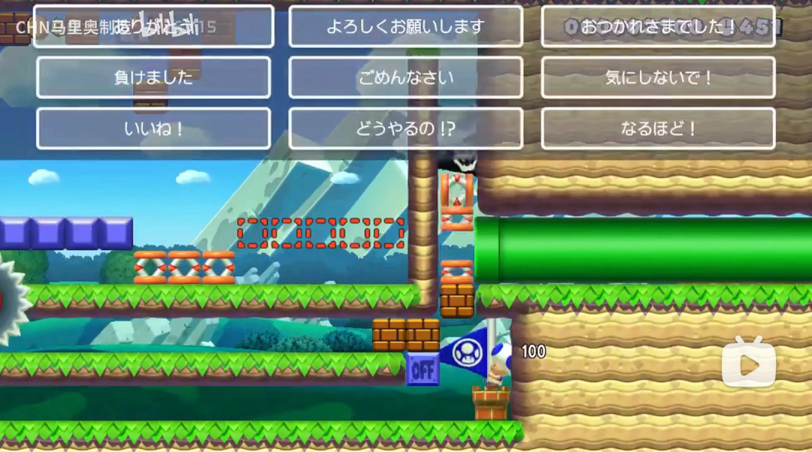
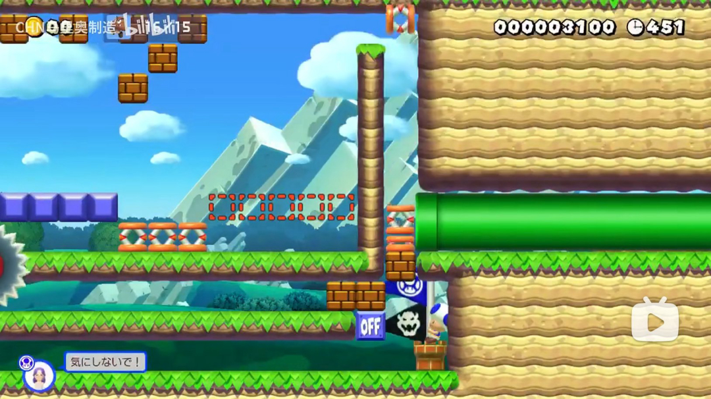

# 快捷消息系统（SMM2 风格）

参考《超级马力欧创作家 2》的快捷聊天：常驻侧栏已移除，改为「全屏快捷用语面板 + 左下角消息气泡」。

## 参考图

快捷用语面板（顶部 4 列 × 6 行的半透明圆角按钮，其余区域点击关闭）：

消息气泡（左下角：头像 + 玩家名 + 消息文本）：

## 交互流程

1. 点击屏幕右侧的消息按钮 → 全屏面板淡入，顶部展示 21 条快捷用语（4 列 × 6 行，按钮高 76）。
2. 面板打开期间游戏不暂停，但玩家操作被临时屏蔽（键盘 + 手柄）；遮罩覆盖整个屏幕。
3. 点击空白区域 → 面板淡出、玩家操作恢复。
4. 点击某条用语 → 该按钮变黄并保持到消息展示结束（约 2.3 秒），面板关闭并发送；左下角气泡从下方滑入弹出（头像 + 玩家名 + 文本），停留约 2 秒后向左滑出并淡出。
5. 发送后进入约 2.3 秒冷却，冷却期间 21 个按钮变暗且点击无效（自己的气泡淡出前无法再次发送）。
6. 同时到达的消息直接堆叠显示，最多 8 条；超出时最早的一条淡出。

## 系统消息（玩家离开 / 与主机断开）

- `MultiplayerPlayerLeft` 仍负责监听玩家列表变化与断线事件，但不再自己弹独立提示；
- 统一调用 `MessageOverlay.show_system_message(text)`，与快捷消息共用同一套滑入、2 秒停留、淡出和 8 条上限，两种消息可以混排堆叠；
- 外观保持原来的纯文字样式（25 号白字 + 黑色描边，无头像、无白色底板），气泡高度 40。

## 实现结构

| 文件 | 作用 |
| --- | --- |
| `object/multiplayer/message_system/message_overlay.tscn` | autoload（`MessageOverlay`）：入口按钮、全屏遮罩、快捷用语网格、气泡层、音频节点 |
| `script/multiplayer/message_system/message_overlay.gd` | 面板开关、CD、消息分发、气泡堆叠布局 |
| `object/multiplayer/message_system/quick_message_button.tscn` | 半透明圆角快捷用语按钮 |
| `object/multiplayer/message_system/message_bubble.tscn` | 单条消息气泡 |
| `script/multiplayer/message_system/message_bubble.gd` | 气泡滑入 / 淡出动画 |
| `script/multiplayer/message_system/player_input_blocker.gd` | 面板期间的玩家输入屏蔽（临时移除 InputMap 事件） |
| `script/multiplayer/message_system/quick_message_table.gd` | 21 条用语的翻译 key 表 |
| `script/multiplayer/0_core/multiplayer_player_left_manager.gd` | 玩家离开 / 断线事件 → 转交 `MessageOverlay.show_system_message()` |

数据与本地化：

- 联机只同步用语序号（`MSG_QUICK_01` … `MSG_QUICK_21`），各端按自己的语言渲染。
- 文本配置在 `i18n/mfmp_translation.csv`（en / zh_CN / ja）。

参数（`message_overlay.gd`）：

- `MAX_BUBBLES = 8`：气泡上限，超出时最早的淡出。
- `SEND_COOLDOWN = 2.3`：发送冷却，对应气泡展示 2.0s + 淡出 0.3s。
- `BUBBLE_MARGIN_LEFT / BOTTOM`：气泡距屏幕左边 / 下边距离。

## 音效

音效来自 SMM2 romfs 导出，命名规则：英文 + `MM2_` 前缀，统一放在 `res://sound/`。

| 文件 | 用途 | 触发 |
| --- | --- | --- |
| `MM2_MultiPlayMessage_Pop.wav` | 消息弹出 | 气泡出现时（同时发出 `message_popped` 信号） |
| `MM2_MultiPlayMessage_In.wav` | 消息列表进场 / 面板开关 | 打开与关闭快捷用语面板共用这一个音效（发送时关闭不播放，避免与 Enter 叠音） |
| `MM2_MultiPlayMessage_Enter.wav` | 发送确认 | 点击某条用语发送 |
| `MM2_MultiPlayMessage_Cursor.wav` | 光标移动 | 鼠标移入某条用语按钮 |

音效节点都在 `message_overlay.tscn`：`MessageSound` / `MsgOpen` / `MsgClose` / `MsgEnter` / `MsgCursor`。
系统消息（玩家离开 / 断线）保持原来的无声提示。

## 头像

气泡左侧是 84×84 的圆形头像槽：`avatar_texture` 有贴图时显示图片，否则显示玩家名首字。后续提供头像素材时，在 `message_bubble.tscn` 或运行时给 `AvatarTexture.texture` 赋值即可。

## 封存内容

旧的常驻侧栏（`message_sidebar.tscn`）、自定义消息输入（`message_sender.gd`）、消息记录落盘（`message_cache.gd`）与历史列表渲染（`message_creator.gd`）均保留在工程中但不再加载，作为日后恢复的参考。
