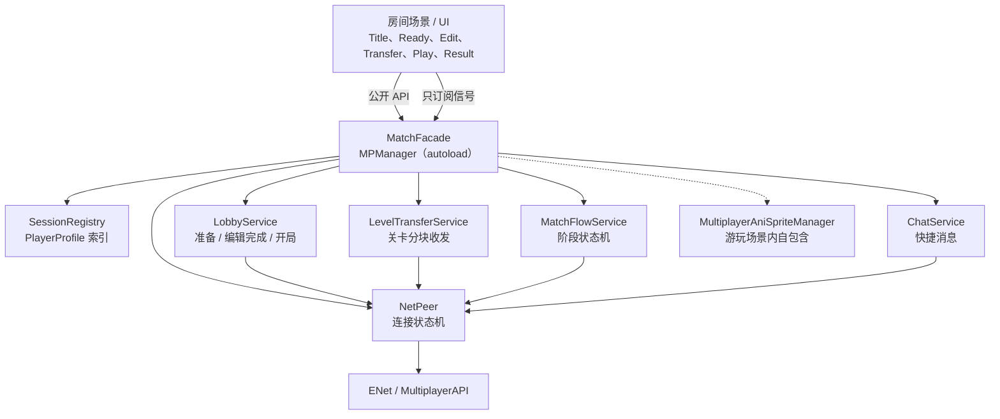

# 多人联机重构方案

本文档是多人联机（`script/multiplayer/**`）的重构基线：先列问题，再定目标模块，最后给分阶段迁移顺序。实施时按阶段推进，每个阶段独立可运行、可回滚。

## 已确认的约束（2026-11-08）

1. **优先目标是"代码难改"**：可读性、可定位性、可增量修改优先于单纯压行数。
2. **允许修改 RPC 协议**：不要求新旧客户端互通；协议升级时用版本号直接拒绝旧客户端。
3. **允许一起改 UI 脚本**：不要求保留 `Array[Dictionary]` 的长期兼容，兼容层只服务于迁移期。
4. **保留 `MPManager` 这个 autoload 名字和 `MultiplayerManager` 的 `class_name`**：现有 30+ 处引用不改名，内部换实现。
5. **不引入新 autoload**：只有 `MPManager` 一个 autoload。它必须是**脚本 autoload**（不能指向 `.tscn`，否则 `MPManager` 的静态类型会退化成 `Node`，所有 `MPManager.net` 之类访问都会编译失败）。各服务在 `_ready()` 里创建为子节点，路径固定为 `/root/MPManager/<Service>`。

---

## 一、现状问题清单

严重度定义：

- **P0**：会导致流程卡死、数据错乱或明显性能问题，必须优先解决。
- **P1**：显著增加修改成本，改一个功能要动多处。
- **P2**：结构不清晰，但短期不阻塞开发。

### P0

#### P0-1 `MultiplayerManager` 是上帝对象（834 行，8 种职责）

`script/multiplayer/0_core/multiplayer_manager.gd` 同时负责：

| 职责 | 代码位置 |
| --- | --- |
| ENet 连接 / 端口 / 超时 / 断线 | 144-183、226-318 |
| 玩家资料与列表 | 48-65、114-131、320-344、370-400 |
| 大厅准备 / 编辑准备 / 开局 | 447-449、733-772 |
| 关卡数据接收与解压 | 451-505 |
| 随机关卡序列 / 单关计数 / 结算 | 507-599 |
| 快捷消息与聊天 | 774-834 |
| 远端玩家动画同步 | 601-664 |
| 反向操作标题界面节点 | 190-218、402-416 |

影响：任何一处修改都要通读 800 行；无法单独测试某一层；新人无法判断某字段归谁管。

#### P0-2 关卡数据混进玩家字典，导致全量广播

`players: Array[Dictionary]` 中每个元素带完整关卡 JSON 字符串 `level_data`。而 `sync_players_list.rpc(players)` 在准备、编辑准备、离开、返回标题等路径反复整表广播（341、359-363、398、728、744、759）。

代码里已经出现"为了绕开大体积数据而分裂字段"的补丁：

```text
my_players_data_are_ready() 只在主机广播 ready，避免把体积庞大的关卡数据再同步一遍
```
（`multiplayer_manager.gd:488-505`）

影响：

- 准备一次可能传输数 MB 冗余数据，弱网直接卡顿；
- `ready` 与 `is_ready_to_start` 变成两套语义相似的字段，极易用错；
- `level_data` 长时间驻留内存，结算时才清空（`reach_end_notifier.gd:40-41`）。

#### P0-3 流程靠客户端本地轮询 + `await` 计时器

- `level_sender_node.gd:37-67`：`while not ready: await 1 秒`，反复扫全表。
- `reach_end_notifier.gd:18-26`：`while` + `await 1.5 秒` 等所有人到终点。
- `timeout_manager.gd:12-50`：自己判断模式、自己决定切场景，还要与 `edit_all_ready` 抢切换（用 `is_finishing` 补丁）。

影响：

- 没有任何失败/超时出口，一个人卡住 → 所有人无限等；
- 客户端和主机各算各的阶段，只能靠"同时切场景"隐式对齐；
- 时序问题（晚一帧、场景未就绪）会表现为"偶发卡在传输房间"，极难复现。

#### P0-4 RPC 身份校验缺失

所有客户端→主机的 RPC 都用 `any_peer`，且以参数里的 `player_id` 为准：

- `get_ready(p_id, is_ready)`（733-745）
- `set_edit_ready(p_id, is_ready)`（748-761）
- `transfer_level_data(player_id, ...)`（451-486）
- `level_add_pass_count(level, passed, player_id)`（524-542）
- `reach_end(player_id)`（544-552）
- `send_quick_message(p_id, unique_id, quick_id)`（774-804）

影响：任一客户端 bug 或恶意修改都能替别人准备、替别人提交关卡、伪造计分。更隐蔽的是这些 RPC 大多带 `call_local`，发送端会先改自己的本地副本，再被主机广播覆盖，产生状态跳变。

#### P0-5 关卡数据单包传输，无分块、无校验、无超时

`transfer_level_data`（451-486）：

- 一次 `rpc` 发送整个压缩包；
- 解压/UTF-8 失败只写 `Log.e` 并置 `"invalid"`，对端无感知；
- 接收端 `level_receiver_node.gd` 用 `level_file_name` 直接 `FileAccess.open` 写盘；
- `level_file_name` 来自客户端，未做路径清洗。

影响：大关卡可能触发底层包大小限制而静默失败；路径可被构造成 `user://../../...`；失败后只能靠玩家发现"我的关卡没进轮换"。

### P1

#### P1-1 UI 与网络层双向强耦合

- 网络层反向操作 UI：`_restore_lobby_page` / `_show_player_page` / `server_closing` 里 `get_node("/root/Title/GameRoomSize/...")`（190-218、410-416）。
- UI 直接连私有方法：`host_button.gd:21`、`join_button.gd:23` 都 `pressed.connect(multiplayer_manager._on_host_button_pressed)`，且按钮内部又连了一次自己的 `_on_button_pressed`，一次点击两套逻辑。
- `lets_play_together.gd:15` 直接调用 `multiplayer_manager._on_peer_disconnected(player_id)`，把网络事件回调当"删除玩家"接口。

影响：网络模块无法脱离 Title 场景运行；UI 无法单独测；断开语义被污染。

#### P1-2 状态是 untyped Dictionary，字段所有者分散

玩家字段分别归大厅、编辑、传输、对局、结算所有，但都塞在同一个字典里：

| 字段 | 实际所有者 |
| --- | --- |
| `is_ready_to_start` | 大厅 |
| `is_ready_to_finish` | 编辑房间 |
| `ready` | 关卡传输 |
| `level_data` / `level_file_name` | 关卡传输 |
| `reach_end` | 结算 |
| `score` / `clear_rate` | 结算 |
| `avatar_id` | UI |

初始化只有一处默认字典（114-131），新增字段靠记忆补；读写全靠字符串 key，拼错不会报错。

#### P1-3 全局单一 `players_updated` 信号 + 线性查找

所有界面都订阅同一个信号，收到后整表重建（`player_list.gd:15-50`、`result_list.gd`、`edit_ready_button.gd:45-60`、`level_transfer_progress_label.gd:23-40`）。查找玩家一律 `for p in players`，全工程重复几十次。

`level_transfer_progress_label` 甚至每帧扫描一遍全表算进度。

#### P1-4 状态赋值夹带副作用

- `players` setter：比较新旧长度来播放加入/离开音效，并在人数 < 2 时重置 `msg_cnt`（48-65）。
- `is_in_game` setter：清空 `random_levels` / `current_level_count` / `total_levels` / `level_results`，并把模式强制设回 EDIT（90-100）。
- `back_to_title_process.gd:12-24` 连续两次 `is_in_game = false`，副作用重复执行。

影响：赋值不再幂等，任何"顺手写一下"都可能触发一整套连锁反应。

#### P1-5 RPC 分散在场景脚本，协议没有清单

除 manager 里的 21 个 RPC，还有场景级 RPC：

- `game_start.gd:23-41` 的 `game_start`
- `back_to_title_together_button.gd:16-18` 的 `back_to_title_together`

RPC 的节点路径依赖当前场景。若两端场景切换不同步，路径不存在，RPC 会静默失败（只打印错误），表现为"按钮点了没反应"。

### P2

#### P2-1 表现数据混入网络层

`MultiplayerManager` 导出 8 个 `SpriteFrames`（102-109），并在 `send_ani_sprite_data`（601-664）里做动画解析、换装、死亡处理。

`multiplayer_ani_sprite_manager.gd:49-53` **每个物理帧** 调用一次 10 参数 RPC（默认发给所有对等体）。3 人局即 60 × 2 × 10 参数的持续广播，与游戏逻辑争抢带宽。

#### P2-2 连接状态用零散变量拼

`_join_deadline_msec`（88）、`_suppress_disconnect_notice`（85）、`_lobby_page`（82）三个变量分别描述"连接中""刚主动断开""从哪个页面来的"，没有统一状态机。

#### P2-3 autoload 场景里塞了非核心节点

`object/multiplayer/multiplayer_manager.tscn` 除脚本外还挂了 `LevelReceiverNode`（落盘）和 `PlayerJoin` / `PlayerExit` 音效节点。落盘逻辑属于传输服务，音效属于大厅表现层。

### 问题 → 目标模块映射

| 问题 | 解决模块 |
| --- | --- |
| P0-1 / P2-3 | 拆 `NetPeer` + 各 Service，`MPManager` 只做门面 |
| P0-2 / P0-5 | `LevelTransferService` + 关卡数据与资料分离 + 分块协议 |
| P0-3 / P1-3 | `MatchFlowService` 阶段机 + 事件驱动 |
| P0-4 / P1-5 | RPC 规范 + `c2s` sender 校验 + 协议集中在 autoload 子树 |
| P1-1 | `TitleNetBridge` + Facade 公开 API |
| P1-2 / P1-4 | `PlayerProfile` + `SessionRegistry` + 副作用移到事件监听 |
| P2-1 | `MultiplayerAniSpriteManager` 自包含动画同步 |
| P2-2 | `NetPeer` 连接状态机 |

---

## 二、目标架构

### 2.1 分层原则

1. **按变化原因分层**：传输、会话数据、业务流程、表现、UI 各自独立变化。
2. **RPC 只放在 autoload 子树**：节点路径在所有场景中恒定，避免场景切换期 RPC 丢失。
3. **主机权威**：所有共享状态由主机裁决，客户端只提交意图、只接受广播。
4. **UI 只订阅信号、只调公开 API**：禁止 `get_node("/root/Title/...")` 反向依赖，禁止调用 `_` 私有方法。
5. **数据与表现分离**：SpriteFrames、动画解析不进会话层。

### 2.2 架构图



### 2.3 目录规划

```text
script/multiplayer/
├── 0_core/
│   ├── multiplayer_manager.gd        # 门面：只做转发、聚合信号、兼容层
│   ├── net_peer.gd                   # 传输层（唯一操作 multiplayer.multiplayer_peer）
│   ├── session_registry.gd           # id -> PlayerProfile，增量信号
│   ├── player_profile.gd             # 强类型玩家模型 + wire 序列化
│   ├── room_phase.gd                 # 阶段枚举 + 合法迁移表
│   └── services/
│       ├── lobby_service.gd
│       ├── level_transfer_service.gd
│       ├── match_flow_service.gd
│       └── chat_service.gd
├── ui/
│   └── title_net_bridge.gd           # Title 场景唯一的网络状态消费者
└── ...                               # 现有 1_game_hall ~ 6_result 逐步精简为纯表现
```

`MPManager` 是脚本 autoload（`project.godot` 指向 `multiplayer_manager.gd`），由 `_ready()` 创建以下子节点：

```text
/root/MPManager (multiplayer_manager.gd)
├── NetPeer               (net_peer.gd)
├── SessionRegistry       (session_registry.gd)
├── LobbyService          (lobby_service.gd)
├── LevelTransferService  (level_transfer_service.gd)
├── MatchFlowService      (match_flow_service.gd)
└── ChatService           (chat_service.gd)
```

按钮音效由门面用 `AudioStreamPlayer` 动态创建，不再需要场景节点。原
`object/multiplayer/multiplayer_manager.tscn` 已删除；`LevelReceiverNode`
并入 `LevelTransferService`。

### 2.4 数据模型

`PlayerProfile` 用 `RefCounted`，只在本地存在；**RPC 一律传 `Dictionary`**，由 `to_wire()/apply_wire()` 显式转换，避免自定义类型在 Godot 网络序列化上的不确定性。

```gdscript
class_name PlayerProfile
extends RefCounted

var id: int
var name: String
var avatar_id: String
var device_id: String
var is_host: bool

var lobby_ready: bool = false        # 大厅“准备”
var edit_finished: bool = false      # 编辑房间“制作完毕”

var has_level: bool = false          # 完整收到并校验通过
var level_file_name: String = ""     # 清洗后的文件名，不含路径
var level_ok: bool = false           # 与 has_level 同义，保留给 UI 过渡

var reach_end: bool = false
var cause_pass: int = 0              # 自己关卡被别人通过
var cause_death: int = 0             # 自己关卡被别人死亡
var pass_count: int = 0              # 自己通过别人的关卡数
var score: int = 0
var clear_rate: float = 0.0
```

**硬规则：`level_data` 不再进入 `PlayerProfile`。** 关卡 JSON 只在 `LevelTransferService` 内部短暂存在，校验通过后落盘，内存只保留文件路径。

`SessionRegistry`：

| 接口 | 说明 |
| --- | --- |
| `get(id) -> PlayerProfile` | O(1)，替代全表 for |
| `all() -> Array[PlayerProfile]` | 只读快照 |
| `size()` / `local() -> PlayerProfile` / `host() -> PlayerProfile` | 常用查询 |
| `add(profile)` / `remove(id)` / `reset()` | 由主机广播驱动 |
| `apply_delta(id, group, dict)` | group = `identity` / `lobby` / `edit` / `transfer` / `match` |
| `to_legacy_array()` | 迁移期给未改完的 UI 用 |

信号：

```gdscript
signal player_added(id: int)
signal player_removed(id: int)
signal player_changed(id: int, group: StringName)
signal registry_reset()
```

不再有"整表变了"的 `players_updated`。迁移期保留该信号，但由 `player_added/removed/changed` 聚合触发，仅用于兼容层。

### 2.5 状态机

**连接状态（`NetPeer`）**

```text
OFFLINE ──host()──▶ HOSTING ──┐
   │                          ├─▶ CONNECTED ──disconnect()──▶ DISCONNECTING ──▶ OFFLINE
   └──join()──▶ CONNECTING ───┘            （超时/失败回到 OFFLINE）
```

对外信号：

```gdscript
signal hosted
signal joined
signal connect_failed(reason: String)
signal server_lost
signal peer_left(id: int, reason: String)
signal state_changed(state: State)
```

`_suppress_disconnect_notice`、`_join_deadline_msec`、`_lobby_page` 全部内聚为状态 + 事件，不再暴露给业务层。

**房间阶段（`MatchFlowService`）**

```text
NONE ──▶ LOBBY ──▶ EDIT ──▶ TRANSFER ──▶ PLAY ──▶ RESULT ──▶ LOBBY
```

规则：

- 只有主机能推进阶段。
- 主机广播 `s2c_phase_changed(phase, payload)`；payload 里带齐该阶段所需参数（编辑时长、随机关卡序列、结算数据）。
- 客户端**不自己判断**何时切场景，只按收到的事件切。
- 所有等待都用"事件 + 超时定时器"，禁止 `while ... await create_timer` 轮询。
- `MPManager.is_in_game` 保留为派生属性：`phase != LOBBY and phase != NONE`，赋值不再触发清零副作用。

阶段迁移表：

| 当前 | 触发 | 下一阶段 | 责任方 |
| --- | --- | --- | --- |
| LOBBY | 房主点开始 + 全员 ready | EDIT | 主机 |
| EDIT | 倒计时结束或全员 edit_finished | TRANSFER | 主机 |
| TRANSFER | 全员 `level_ok` 或超时策略满足 | PLAY | 主机 |
| PLAY | 全员 reach_end 或最后一关结束 | RESULT | 主机 |
| RESULT | 房主点返回 / 全员返回 | LOBBY | 主机 |

### 2.6 RPC 协议规范

| 类型 | 命名 | 注解 | 入口要求 |
| --- | --- | --- | --- |
| 客户端→主机 | `c2s_*` | `@rpc("any_peer", "call_remote", "reliable")` | 第一行判 `is_server()`；用 `get_remote_sender_id()` 取身份，**忽略参数里的 id**；校验阶段 |
| 主机→客户端 | `s2c_*` | `@rpc("authority", "call_local", "reliable")` | 只发增量/事件 |
| 远端动画 | `s2c_anim_*` | `@rpc("any_peer", "call_remote", "unreliable_ordered", 1)` | ≤ 15 Hz，单包 ≤ 64 字节 |
| 大块数据 | `c2s_blob_*` / `s2c_blob_*` | `@rpc(..., "reliable", 2)` | 分块 + hash + 超时 |
| 聊天 | `c2s_chat_*` / `s2c_chat_*` | `@rpc(..., "reliable", 3)` | 序号校验、去重 |

硬规则：

1. **`@rpc` 只能出现在 `script/multiplayer/0_core/**`**；房间场景脚本不允许再定义 RPC。
2. `c2s_*` 不允许加 `call_local`，避免发送端乐观修改后又被广播覆盖。
3. 每个 `c2s_*` 必须有阶段守卫，例如：

```gdscript
@rpc("any_peer", "call_remote", "reliable")
func c2s_set_lobby_ready(value: bool) -> void:
    if not multiplayer.is_server():
        return
    if phase != RoomPhase.LOBBY:
        return
    var sender: int = multiplayer.get_remote_sender_id()
    registry.set_lobby_ready(sender, value)
```

4. 协议版本常量 `PROTOCOL_VERSION` 放在 `NetPeer`；客户端握手时上报，不匹配直接拒绝并提示"版本不一致"。

### 2.7 关卡数据传输协议

替换现有 `transfer_level_data(player_id, name, bytes)`。

**分块**

```text
c2s_level_begin(file_name: String, total_size: int, total_chunks: int, sha256: String)
c2s_level_chunk(index: int, bytes: PackedByteArray)     # 32 KiB / 块
c2s_level_end()
```

**主机校验**

- `file_name` 只取 `get_file()`，必须以 `.lvl` 结尾，拒绝路径分隔符与 `..`；
- `total_size ≤ 16 MiB`，`total_chunks ≤ ceil(total_size / 32KiB)`；
- `index` 不重复、不越界；块乱序允许，按 index 组装；
- 收齐后校验 SHA-256，失败则删除临时文件并要求重传一次；
- 写入 `user://` 下的临时文件，成功后 `rename`；路径由主机生成（`<时间戳>_<清洗后玩家名>_<id>.lvl`），不接受客户端给的完整路径。

**进度与失败**

- 主机每 500 ms 广播一次 `s2c_transfer_progress(id, received_bytes, total_bytes)`（unreliable）；
- 每人 30 秒超时，最多重传 1 次；
- 超时/失败 → `s2c_transfer_failed(id, reason)`，由 `MatchFlowService` 决定剔除该玩家或中止；
- 默认策略：**剔除该玩家并继续**（保持现有"没数据就移除"的语义），并在 UI 上提示。

### 2.8 房间场景职责

| 场景 | 保留 | 移除 |
| --- | --- | --- |
| `title.tscn` | 页面显隐、输入框、`TitleNetBridge` | 直接连 MPManager 私有方法 |
| `ready_room.tscn` | 玩家列表表现 | 自己判断开始条件 |
| `edit.tscn` | 编辑器、编辑准备按钮表现 | 自己切场景 |
| `level_transfer_room.tscn` | 进度展示 | 轮询等待、`lets_play_together` 本地洗牌 |
| `play.tscn` | 关卡玩法、远端玩家表现 | 计分聚合、关卡索引进度判断 |
| `result_room.tscn` | 结果列表表现 | 本地重算分数、轮询等待 |

---

## 实施状态（2026-11-08）

阶段 0~5 已完成首轮实施，`tools\mp_test.bat auto` 与 `auto -Full` 均通过
（大厅 → 编辑 → 传输 → 游玩 → 结算 → 退出，三实例无脚本错误）。

与本文原始设计的偏差，以代码为准：

1. **autoload 改为脚本**：`MPManager="*res://script/multiplayer/0_core/multiplayer_manager.gd"`，
   服务在 `_ready()` 内 `new()` + `add_child()`；原因见“已确认的约束”第 5 条。
2. **关卡数据传输改为“客户端 → 主机 → 所有客户端”星形中继**，分块 32 KiB +
   SHA-256 + 45 秒超时；失败玩家默认剔除并继续。
3. **游玩阶段关卡索引保持各客户端本地递增**（用户确认），主机只聚合单关结果与结算。
4. **结算数据保存在 `MatchFlowService.last_results`**：RESULT 阶段先广播再切场景，
   `result_list` 在 `_ready()` 里补读，避免场景晚加载导致列表为空。
5. **`--mp-auto-finish` + `mp_test.ps1 -Full`** 覆盖完整链路；普通 `auto` 仍只测大厅。
6. **远端玩家动画 RPC 留在 `5_play/multiplayer_ani_sprite_manager.gd`**：它只在游玩场景内
   使用，两端节点路径一致，且与 SpriteFrames 表现资源同处一个组件；其余 RPC 全部集中在
   `0_core/**`。
7. **结果页返回标题**：只有主机按返回才会广播 `LOBBY` 让所有人一起回标题；客户端按返回
   只切换自己的场景，不向主机发 RPC，不能替其他人决定。

## 三、迁移顺序

总原则：**每个阶段结束时游戏必须能完整跑通**。阶段之间不并行改同一文件。每阶段一个提交（或一组小提交），提交信息带 `mp-refactor: stage N`。

### 总览

| 阶段 | 主题 | 主要产出 | 预估 | 风险 |
| --- | --- | --- | --- | --- |
| 0 | 回归基线 | 现有流程可重复验证 | 0.5 天 | 低 |
| 1 | 数据模型 | `PlayerProfile` + `SessionRegistry` | 1.5 天 | 中 |
| 2 | 传输层 + UI 桥 | `NetPeer` + `TitleNetBridge` | 1.5 天 | 中 |
| 3 | 流程服务 | Lobby / Transfer / MatchFlow / Chat | 2.5 天 | 高 |
| 4 | 协议加固 | sender 校验、分块、限频、版本号 | 1.5 天 | 中 |
| 5 | 清理 | 删兼容层、更新文档 | 0.5 天 | 低 |

### 阶段 0：回归基线

**改动**

- 不改业务代码。
- 用 `tools\mp_test.bat auto` 记录一份 PASS 日志到 `tools/mp_test_logs/`。
- 用 `tools\mp_test.bat human` 手动跑一遍完整链路并记录关键日志：大厅 → 编辑 → 传输 → 游玩 → 结算 → 回大厅。

**验收**

- `auto` 模式四项全 PASS：两个客户端加入、三人准备、开局并退出。
- 手动全链路有一份可对比的日志。

**回滚**：无代码改动。

### 阶段 1：数据模型类型化

**新增**

- `0_core/player_profile.gd`
- `0_core/session_registry.gd`
- `0_core/room_phase.gd`（先只放枚举，阶段 3 再接状态机）

**修改**

- `multiplayer_manager.gd`
  - 内部 `players` 改为 `Dictionary[int, PlayerProfile]`；
  - 新增 `registry` 引用；
  - `players` 保留为只读兼容属性：由 registry 合成 `Array[Dictionary]`；
  - `players_updated` 保留，由 registry 的增量信号聚合触发。
- 所有写入点改为调 registry：
  - `register_player_on_host`、`_on_peer_disconnected`、`get_ready`、`set_edit_ready`、`sync_player_ready`、`level_add_pass_count`、`reach_end`、`restore_origin_player_data`、`sync_origin_player_data`。
- 所有读取点改为类型化访问（约 20 个文件）：
  - `player_list.gd`、`ready_button.gd`、`edit_ready_button.gd`、`level_transfer_progress_label.gd`、`result_list.gd`、`reach_end_notifier.gd`、`play_next_level_manager.gd`、`random_capture.gd`、`message_overlay.gd`、`message_siderbar_status.gd`、`message_cache.gd`、`message_creator.gd`、`multiplayer_player_left_manager.gd`、`level_sender_node.gd`、`lets_play_together.gd` 等。

**验收**

- `rg 'players\[' script` 只剩兼容 getter 与 `to_legacy_array()`。
- `rg 'for .* in .*players' script` 只剩必须遍历全体的展示代码。
- `mp_test.bat auto` PASS；手动全链路 PASS。
- 音效仍只在"有人加入/离开"时播放（副作用已从 setter 移到 `player_added` / `player_removed` 监听）。

**回滚**：删新文件，`list` 恢复；兼容 getter 保证 UI 期间可用。

### 阶段 2：拆传输层 + UI 信号化

**新增**

- `0_core/net_peer.gd`
- `script/multiplayer/ui/title_net_bridge.gd`
- `title.tscn` 挂 `TitleNetBridge` 节点

**修改**

- `multiplayer_manager.gd`
  - 移除所有 `ENetMultiplayerPeer` 创建、端口校验、`_process` 超时、`_suppress_disconnect_notice`；
  - `host_game(port, player_name)` / `join_game(ip, port, player_name)` / `leave_room(reason)` 转调 `NetPeer`；
  - 删除 `_restore_lobby_page` / `_show_player_page` 里的 `get_node("/root/Title/...")`；
  - `net.peer_left` → 移除玩家 + 广播 delta。
- `host_button.gd` / `join_button.gd`
  - 删除重复的 `pressed.connect(multiplayer_manager._on_...)`；
  - 只调用公开 API；
  - 页面显隐交给 `TitleNetBridge`。
- `quit_button.gd`：改为 `MPManager.leave_room("主动退出")`。
- `multiplayer_manager.tscn`：加入 `NetPeer` 子节点。

**验收（逐条手测）**

1. 端口被占用 → 开房失败，停在 HostPage，提示正确；
2. 地址不通 → 10 秒内失败，停在 JoinPage；
3. 房主关房 → 客户端提示"与主机断开"，回 JoinPage；
4. 客户端主动退出 → 服务端移除，不误报断开；
5. 游戏进行中有人加入 → 拒绝并提示。

**回滚**：`NetPeer` 内部可先复制原逻辑，门面切回旧调用即可。

### 阶段 3：拆流程服务

这是改动面最大的一阶段，按 3 个小步提交。

**3a：LobbyService**

- 搬 `get_ready` / `set_edit_ready` / `_check_all_edit_ready` / `game_start`。
- `ready_button.gd`、`edit_ready_button.gd`、`game_start.gd` 改为调服务 API。
- 删除 `game_start.gd` 自己的 `@rpc`，开局只由 `MatchFlowService` 广播。

**3b：LevelTransferService + MatchFlowService**

- 搬 `transfer_level_data`、`my_players_data_are_ready`、`lets_play_together`。
- 新流程：
  1. 主机进入 TRANSFER → 广播；
  2. 各端 `LevelTransferService` 主动发送自己的关卡（不再等场景 `_ready` 轮询）；
  3. 收齐 → 主机洗牌一次 → 广播 `s2c_phase_changed(PLAY, {random_levels})`；
  4. 各端收到 PLAY 才切场景。
- 删除 `level_sender_node.gd`、`level_receiver_node.gd` 的轮询逻辑；`level_receiver_node.gd` 并入服务后删除。
- `timeout_manager.gd` 只保留"倒计时到点/全员完成 → 通知 MatchFlow"，不再判断模式、不再切场景。
- `level_transfer_progress_label.gd` 改为订阅 `progress_changed`，不再 `_process` 每帧扫表。
- `reach_end_notifier.gd` 改为"上报 + 订阅 `all_reached_end`"，删除 `while await`。
- `play_next_level_manager.gd` 的关卡推进由 `MatchFlowService` 广播的关卡索引驱动。

**3c：ChatService**

- 搬 `messages`、`msg_cnt`、`send_quick_message`、`send_message`、`sync_messages`。
- `message_overlay.gd`、`message_siderbar_status.gd`、`message_cache.gd`、`message_creator.gd`、`message_quick_sender.gd` 改读 `MPManager.chat`。
- 删除 `message_siderbar_status.gd:45` 的直接 `messages.clear()`，改调服务方法。

**验收**

- 传输中任一客户端掉线：其余人 5 秒内收到 `transfer_failed`，流程继续，不死等。
- 全员完成编辑：只切一次场景。
- 结算等待有人掉线：主机超时后按已到人数结算。
- `rg 'while not .* await' script/multiplayer` 无结果。
- `mp_test.bat auto` PASS + 手动全链路 PASS。

**回滚**：按 3a/3b/3c 三个提交分别回滚。

### 阶段 4：协议加固

**改动**

- 所有 `c2s_*` 改用 `get_remote_sender_id()`；删除参数里的 `player_id`（或保留但仅做一致性校验，不一致直接丢弃）。
- 关卡传输改分块协议（见 2.7），加 SHA-256、超时、重传。
- `send_ani_sprite_data` 改为：
  - 发送频率降到 12~15 Hz；
  - 参数打包为单个 `PackedByteArray`（位置、缩放、旋转、套装、动画 id、帧、翻转、死亡位）；
  - 接收端做插值，避免 15 Hz 抖动。
- 加入 `PROTOCOL_VERSION` 握手，不一致拒绝。
- 新增 `docs/multiplayer_protocol.md`：从本文附录迁移为正式清单。

**验收**

- 伪造 id 的准备/计分 RPC 被忽略（用 `MpTestBoot` 加一个调试参数手动发一次验证）。
- 8 MiB 关卡可完整传输，进度条连续更新。
- 故意篡改一块数据 → 校验失败、提示、重传一次。
- 3 人局游玩时网络发送量相比改造前明显下降（记录 `Performance.MONITOR_NETWORK_OUT` 对比）。

### 阶段 5：清理

**改动**

- 删除 `players` 兼容 getter、`players_updated` 兼容信号、`to_legacy_array()`。
- 删除 `restore_origin_player_data` 里逐字段重置的重复代码（改为 `profile.reset_match_state()`）。
- 删除 `MpTestBoot` 里对 `_on_join_button_pressed` 的调用，改走公开 API。
- 更新 `docs/multiplayer_refactor_plan.md` 状态为"已完成"，补一份最终模块图。

**验收**

- `multiplayer_manager.gd` ≤ 450 行（首轮 438，含兼容属性 / 日志辅助；后续可继续外移）。
- `rg 'MPManager\.players' script` 只命中门面兼容属性与只读消费方（无写入）。
- `rg '@rpc' script/multiplayer --glob '!0_core/**'` 只允许 `5_play/multiplayer_ani_sprite_manager.gd`。
- `mp_test.bat auto` + 手动全链路 PASS。

---

## 四、验证方案

### 自动化

| 工具 | 覆盖 | 说明 |
| --- | --- | --- |
| `tools\mp_test.bat auto` | 大厅：开房、加入、准备、开局、退出 | 现有；作为每阶段必跑项 |
| `tools\mp_test.bat human` | 可视化全链路 | 手动操作，观察 UI 与音效 |

阶段 3 之后建议给 `mp_test.ps1` 增加两个标记检查：

- `transfer complete`：全部关卡接收完成；
- `result stored`：结算广播完成。

这样 `auto` 能覆盖到结算，而不只是"开局后退出"。

### 手动回归清单

每个阶段结束至少跑一次：

1. 2 人局完整流程；
2. 3 人局完整流程；
3. 编辑阶段一人退出；
4. 传输阶段一人退出；
5. 游玩阶段一人退出；
6. 房主中途退出；
7. 重复开关房 3 次（检查端口释放）；
8. 中文名 / 12 字符上限 / 头像选择。

### 日志检查

- 无 `RPC not allowed`；
- 无 `Node not found` / `Path not found`；
- 无 `E 0:00:...` 级别的 `@rpc` 序列化错误；
- 断线与错误提示各只出现一次（当前存在重复提示风险）。

---

## 五、风险与对策

| 风险 | 影响 | 对策 |
| --- | --- | --- |
| 一次性改太多，回归困难 | 高 | 严格按阶段提交；每阶段先跑 `auto` 再手测 |
| UI 迁移遗漏导致读旧字段 | 中 | 阶段 1 保留兼容 getter，用 `rg` 清单逐文件勾选 |
| RPC 迁移后路径变化 | 中 | 全部集中到 autoload 子树；迁移期新旧 RPC 并存一个提交，验证后再删旧 |
| 大关卡分块引入新时序 bug | 中 | 先做"单包 + hash + 超时"过渡，再切分块；保留开关 |
| `level_file_name` 路径清洗影响现有存档 | 中 | 只清洗网络传入值，本地编辑保存路径不动 |
| 动画降频导致远端玩家卡顿 | 低 | 客户端插值；保留 `--mp-anim-debug` 开关对比 |
| 兼容层长期不删 | 低 | 阶段 5 设硬性验收：`MPManager.players` 引用为 0 |
| Godot 4 场景/脚本移动导致 uid 断链 | 中 | 在编辑器内移动文件；改完跑一次 `--import` 与 `auto` |

---

## 六、明确不做

以下内容本次重构不涉及，避免范围膨胀：

- 主机迁移（host migration）；
- 断线重连；
- 帧同步 / 回滚网络；
- NAT 穿透、房间列表、匹配服务器；
- 中途加入对局（维持"开局后拒绝"）；
- 恢复自定义文本聊天（保持封存状态）；
- 观看模式（另有 `docs/spectator_mode/`）。

## 七、待定事项

1. 传输阶段有人失败时，默认"剔除该玩家继续"是否符合预期？备选是"整局中止回大厅"。
2. 游玩阶段的关卡索引是否要改为主机权威？当前是各客户端本地递增，理论上可能不同步；建议阶段 3 一并改成主机广播关卡索引。
3. 是否需要在阶段 0 就给 `mp_test.ps1` 加全链路标记，还是等阶段 3 再加。
4. `game_start_time` 目前同时承担"存档文件名时间戳"和"对局标识"，是否要拆成两个字段。

---

## 附录：现有 RPC 清单

### `multiplayer_manager.gd`

| 行 | 函数 | 注解 | 目标归属 |
| --- | --- | --- | --- |
| 320 | `register_player_on_host` | any_peer / remote | LobbyService `c2s_join_room` |
| 346 | `inform_late_player` | authority / remote | LobbyService `s2c_join_rejected` |
| 352 | `player_joined` | authority / local | LobbyService `s2c_player_joined` |
| 358 | `sync_players_list` | authority / local | SessionRegistry `s2c_roster_snapshot` |
| 403 | `server_closing` | authority / local | NetPeer `s2c_server_closing` |
| 418 | `notify_disconnect` | any_peer / remote | NetPeer `c2s_leave_reason` |
| 447 | `edit_time_out` | authority | MatchFlowService `s2c_phase_changed` |
| 451 | `transfer_level_data` | any_peer / local | LevelTransferService 分块协议 |
| 488 | `my_players_data_are_ready` | any_peer / local | LevelTransferService `c2s_level_end` |
| 499 | `sync_player_ready` | authority / local | SessionRegistry delta |
| 507 | `lets_play_together` | authority / local | MatchFlowService `s2c_phase_changed(PLAY)` |
| 524 | `level_add_pass_count` | any_peer / local | MatchFlowService `c2s_level_result` |
| 544 | `reach_end` | any_peer / local | MatchFlowService `c2s_reach_end` |
| 554 | `store_level_results` | authority / local | MatchFlowService `s2c_results` |
| 601 | `send_ani_sprite_data` | any_peer / remote / unreliable_ordered(1) | MultiplayerAniSpriteManager |
| 723 | `sync_origin_player_data` | any_peer / local | SessionRegistry `s2c_roster_snapshot` |
| 733 | `get_ready` | any_peer / local | LobbyService `c2s_set_lobby_ready` |
| 748 | `set_edit_ready` | any_peer / local | LobbyService `c2s_set_edit_finished` |
| 774 | `send_quick_message` | any_peer / local / reliable(10) | ChatService `c2s_chat_quick` |
| 808 | `send_message` | any_peer / local / reliable(10) | ChatService（封存，保留） |
| 832 | `sync_messages` | authority / local / reliable(10) | ChatService `s2c_chat_sync` |

### 场景脚本

| 文件 | 行 | 函数 | 目标归属 |
| --- | --- | --- | --- |
| `1_game_hall/game_start.gd` | 23 | `game_start` | LobbyService / MatchFlowService |
| `6_result/back_to_title_together_button.gd` | 16 | `back_to_title_together` | MatchFlowService `s2c_phase_changed(LOBBY)` |

迁移完成后，`script/multiplayer/0_core/**` 之外不应再出现 `@rpc`。
